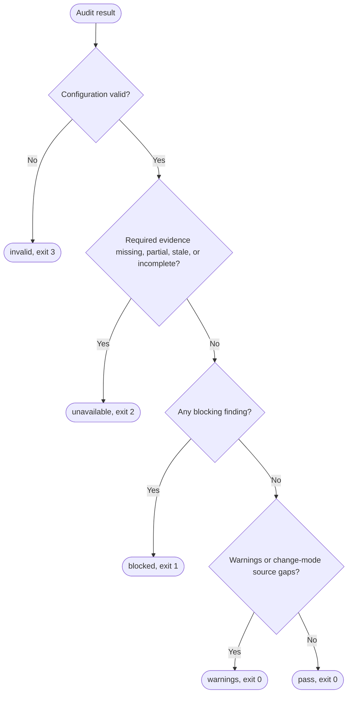

# security-audit-skill

An [Agent Skills](https://agentskills.io/specification)-compatible skill for carrying out security
audits. The current capability is a **dependency vulnerability audit**: it audits an exact resolved
dependency snapshot against OSV, CISA KEV, and ecosystem-native audit tools, and writes reviewable
JSON and Markdown evidence with a stable pass/warn/block/unavailable exit code. Built for Claude
Code, and portable to any tool that reads the open `SKILL.md` format.

Spun off from the now-deprecated `spec-driven-development-skills`, where it was
`dependency-security-audit`.

## What it does

- **Exact inventory.** Resolves direct and transitive versions for npm, pip, Cargo, and Go, or
  accepts a CycloneDX 1.4–1.7 JSON SBOM. An incomplete inventory is always reported, never hidden.
- **Authoritative evidence.** OSV and native adapters decide applicability and fixes; CISA KEV
  marks known exploitation; GitHub and NVD add optional enrichment.
- **Three modes.** `change` (manifest or lockfile changed), `main` (entering protected main), and
  `release`. Main and release always run a fresh, complete audit.
- **Fails closed.** A source failure never means "no vulnerabilities". Missing, partial, or stale
  required evidence yields `unavailable`, not `pass`.
- **Reachability and policy.** Optional reachability evidence and a stricter policy file; unproven
  claims fall back to `unknown`.
- **Advisory search.** A separate informational lookup by package version, advisory ID, or CVE.

## Install

The skill lives in `skills/security-audit-skill/`. Link or copy that directory to where your agent
loads skills, keeping the directory name equal to the skill name (`security-audit-skill`):

```bash
git clone https://github.com/sohampatwardhan/security-audit-skill ~/GitRepos/security-audit-skill
ln -s ~/GitRepos/security-audit-skill/skills/security-audit-skill ~/.claude/skills/security-audit-skill
```

Requires Python 3.10+ (standard library only) and network access. `npm`, `pip-audit`,
`cargo-audit`, and `govulncheck` are used only when their ecosystem is in the inventory.

## Usage

Agents load [`SKILL.md`](SKILL.md) automatically when you add or upgrade a dependency, change a
lockfile, prepare a main or release revision, or investigate an advisory. The CLIs can also be run
directly from `skills/security-audit-skill/`:

```bash
python3 scripts/dependency_security_audit.py --root /path/to/project --mode main --revision REVISION --format json
python3 scripts/dependency_advisory_search.py package --ecosystem PyPI --name requests --version 2.31.0 --format json
```

Reports are written to `PROJECT/.security-audit/dependency-audit/` (`latest.json`, `latest.md`; main and
release also keep timestamped copies). Credentials are passed as environment-variable **names**
(`--github-token-env`, `--nvd-api-key-env`), never values. Release evidence for no-fix findings
goes in `--acceptances` (format in `references/policy.md`).

| Exit | Status | Meaning |
|---:|---|---|
| 0 | `pass` / `warnings` | Evidence complete; warnings still need review |
| 1 | `blocked` | A finding blocks delivery |
| 2 | `unavailable` | Required evidence missing, partial, stale, or unwritable |
| 3 | `invalid` | Invalid invocation or configuration |

How the audit decides its status and exit code:



## Structure

```text
security-audit-skill/
├── skills/security-audit-skill/    # The skill itself (what gets installed)
│   ├── SKILL.md                    # Entry point (frontmatter + workflow)
│   ├── agents/openai.yaml          # Agent-specific display metadata
│   ├── references/                 # Loaded on demand: policy.md, sources.md
│   └── scripts/                    # CLIs and the dependency_audit package
├── tests/                          # Offline unit tests and fixtures
├── AGENTS.md                       # Contributor and maintainer instructions
└── .specs/                         # Historical build spec (not read by agents)
```

## Testing

```bash
PYTHONDONTWRITEBYTECODE=1 python3 -m unittest discover -s tests -v
```

Tests are offline. `tests/live_smoke.py` is an opt-in check against the live sources.

## License

[MIT](LICENSE)
