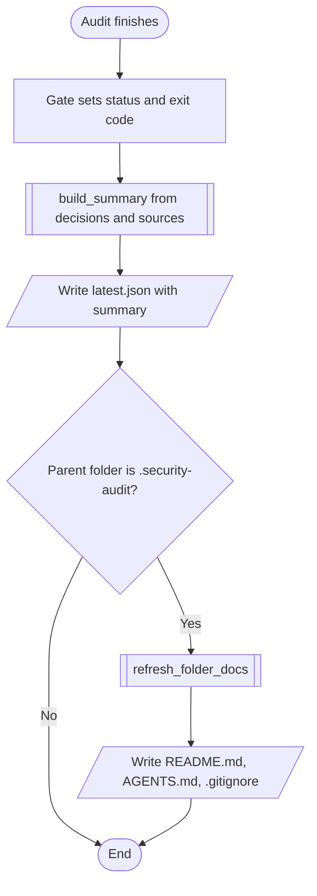
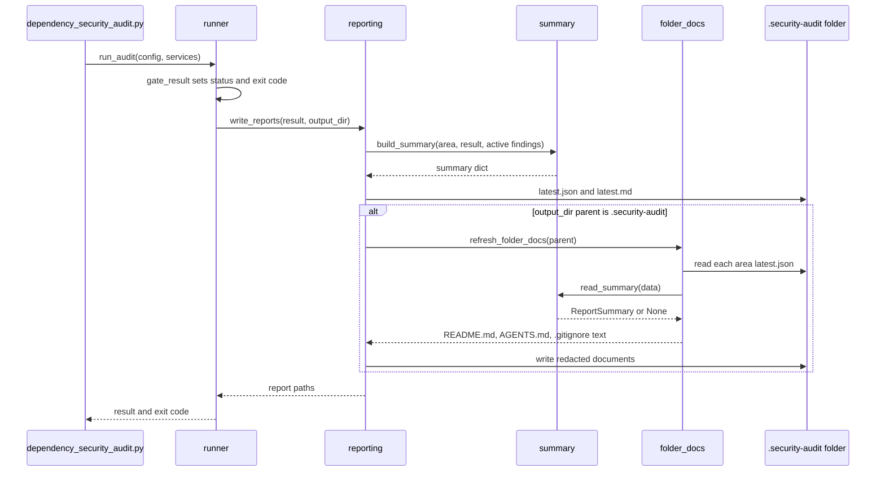
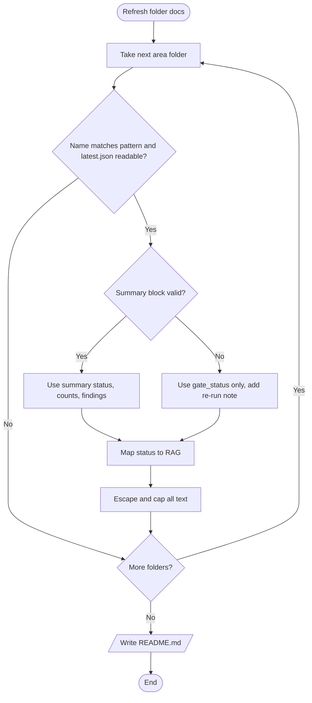
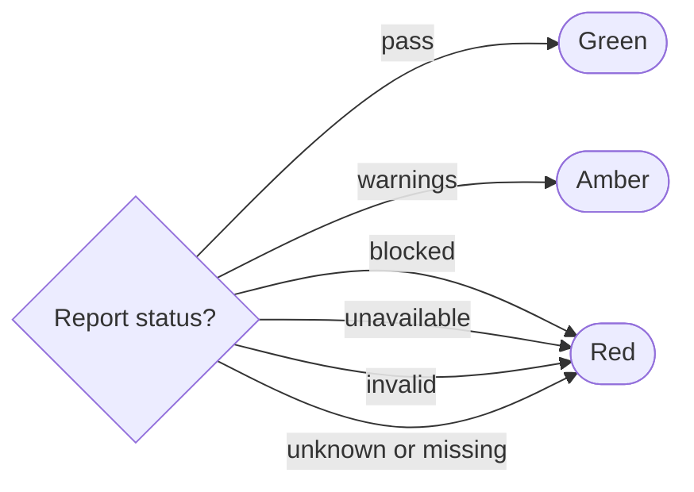
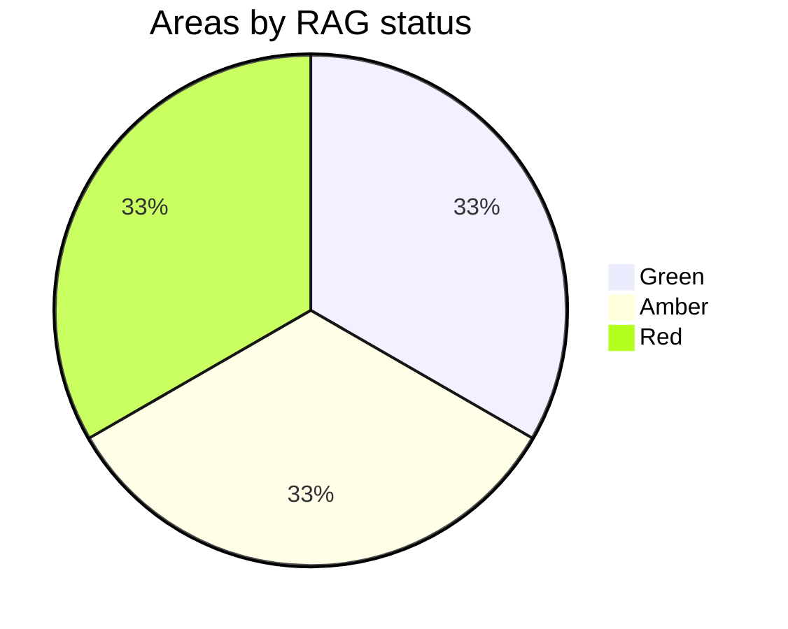

# Report summary contract (foundation phase): design

Date: 2026-11-18
Status: draft, awaiting approval

## Intent

`security-audit-skill` will grow beyond dependency audits (secrets, IaC, SAST, supply chain,
artifacts). The generated `.security-audit/README.md` must summarize every area, but today it reads
dependency-shaped fields (`findings[].package`, `findings[].advisory`), so a secret or SAST report
would break it. This phase gives areas one shared, area-neutral way to describe themselves to that
README, and nothing more.

## Goals

1. Define a `summary` block that any area writes into its `latest.json`.
2. Make the README read only that block, with a defined fallback for reports that lack it.
3. Have the dependency audit write the block, additively, with no change to its exit codes, report
   paths, decisions, or existing JSON fields.
4. Show each area's status, and the folder's overall status, as a RAG (red, amber, green) indicator
   with a small chart in the generated README.

## Non-goals

- No new audit areas, no `Area` protocol, registry, `AreaResult` envelope, or unified
  `security_audit.py` CLI. Those wait until a second area shows what they should look like.
- No change to how the dependency audit collects evidence, classifies findings, or gates.

## Anti-goals

- A summary that can make a bad result look better than the full report. Status and counts come from
  the same decisions as the gate, never recomputed separately.
- Letting an area's summary inject markup, links, or paths into a document that may be published.
- Breaking existing consumers of `latest.json` (schema change must be purely additive).
- A RAG indicator greener than the evidence: anything not clearly `pass` or `warnings` is red.

## Constraints

- Python 3.10+, standard library only; offline deterministic tests; fail closed.
- The README treats every summary field as untrusted input (it is read from disk, and future areas
  are written by others): escape text, restrict enums, cap sizes.
- Reports and the README may be published: no credential values, local paths, or hostnames.

## Approaches

| Approach | Trade-off |
| --- | --- |
| A. Envelope, protocol, registry, unified CLI | Cleanest end state, but designed from a single example. |
| B. Generalize `AuditResult` and `gate_result` in place | One engine, but highest regression risk across the dependency path and all tests. |
| **C. Summary contract first (chosen)** | Smallest change; the summary is the only thing areas actually share today. No single entry point until a later phase. |

Chosen: **C**, by the user.

## Design

### Flow: from audit to README

How a report becomes the folder summary. The README is rebuilt from every area's `latest.json`, so one
area's audit refreshes the whole summary.



The same sequence, by component:



### The `summary` block

Added to every report's JSON at schema version `1.1` (was `1.0`):

```json
"summary": {
  "area": "dependency-audit",
  "status": "blocked",
  "mode": "change",
  "counts": {"blocking": 1, "warnings": 2, "excluded": 0, "source_gaps": 1},
  "top_findings": [
    {"severity": "high", "id": "GHSA-xxxx", "subject": "pkg:npm/a@1.0.0", "flags": ["known_exploited"]}
  ],
  "more_findings": 3,
  "source_gaps": [{"source": "nvd", "state": "partial"}]
}
```

- `status` is the report's `GateStatus`; `mode` is `change`, `main`, or `release`.
- `status` and the decision `counts` are derived from the same gate result the exit code uses.
  `source_gaps` lists every partial or unavailable source and inventory status, including optional
  enrichment sources a main or release gate does not require, so a gap is never hidden.
- `top_findings` is capped at 10, ordered known-exploited first then by severity. `subject` is a
  neutral label (a package URL, a file and line, a resource). `flags` is a list of known values.
  `more_findings` counts the rest.
- Plain data only: strings, integers, lists. No nested area-specific objects.

### Code

- New `skills/security-audit-skill/scripts/dependency_audit/summary.py`: `build_summary(...)` for
  writers and `read_summary(data)` for readers, which validates and sanitizes. It lives in the
  existing package for now; moving it to a neutral package is a rename when a second area arrives
  (my call).
- `reporting.render_json` adds `summary` from the completed result.
- `folder_docs.py` reads the summary through `read_summary` and drops its dependency-specific
  parsing (`_top_findings`, `_decision_counts`, `_source_gaps`).

### Reading the summary into the README



### Reading rules (untrusted input)

- The README shows the worst of `summary.status`, the report's `gate_status`, and the status the
  counts imply (blocking means at least blocked, warnings at least warnings); findings dropped by the
  cap are always added to `more_findings`.
- Enums restricted to known values (`status`, `mode`, severity, flags); unknown becomes `invalid`,
  `-`, `unknown`, or is dropped.
- Text fields flattened, HTML- and Markdown-escaped, and length-capped; lists capped.
- Area folder names must match `[A-Za-z0-9._-]+` before being linked.

### RAG status

RAG is derived from `status` at render time and is not stored in the schema. The README shows it with a
word as well as a symbol, so colour is never the only signal. The folder's overall RAG is the worst area's.

| Status | RAG |
|---|---|
| `pass` | 🟢 Green |
| `warnings` | 🟠 Amber (review needed, never "clean") |
| `blocked` | 🔴 Red |
| `unavailable` | 🔴 Red (safety not established) |
| `invalid`, unknown, or missing | 🔴 Red |



The README gets a RAG column in its table, an overall banner, a legend, and a pie of areas by RAG
(zero-count slices omitted; slice colours are Mermaid's defaults, so the labels carry the meaning). For
example, with one area in each state:



### Compatibility

- A report without `summary` (schema `1.0`) still appears in the README using only `gate_status`,
  `mode`, and `timestamp`, with counts shown as `-` and a note to re-run the audit.
- All existing fields are unchanged. `references/` documents schema `1.1` and the summary block.

### Testing

- Regenerate `tests/fixtures/expected-report.*` for schema `1.1`; golden tests prove all other fields
  and exit codes are unchanged.
- `rag_for` maps every status to the table above and sends unknown values to red; the README overall RAG
  is the worst area's; the pie omits zero slices and contains only counts.
- `build_summary` agrees with `gate_result` for pass, warnings, blocked, and unavailable.
- `read_summary` and the README: missing summary fallback, unknown enum values, oversized lists and
  text, and injection attempts in every field (reuse the existing injection test pattern).

## Left to the builder

- Exact severity ordering ties and the `flags` vocabulary beyond `known_exploited`.
- The exact emoji and legend wording for RAG.
- Wording of the fallback note for pre-`1.1` reports.
- Whether `read_summary` returns a dataclass or a plain dict.
