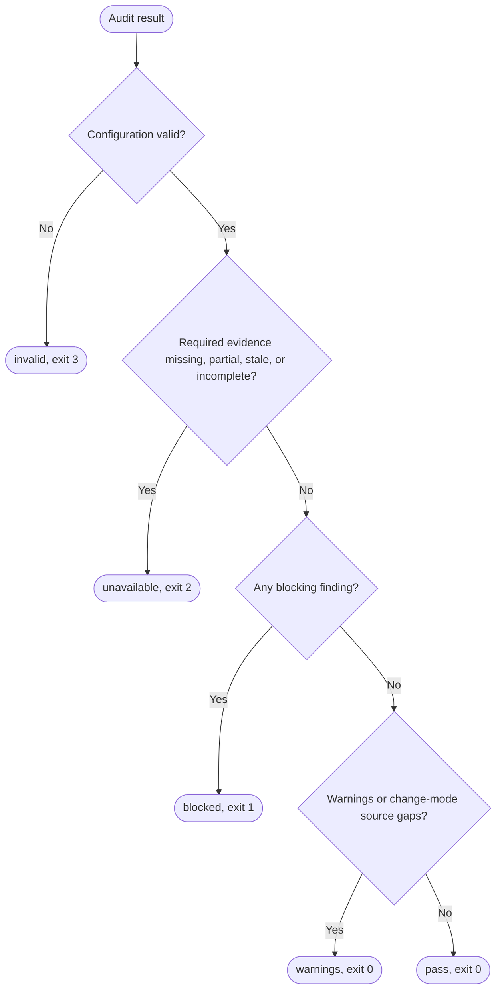
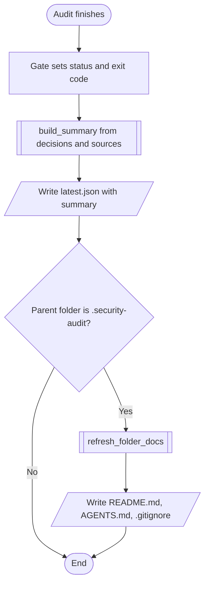
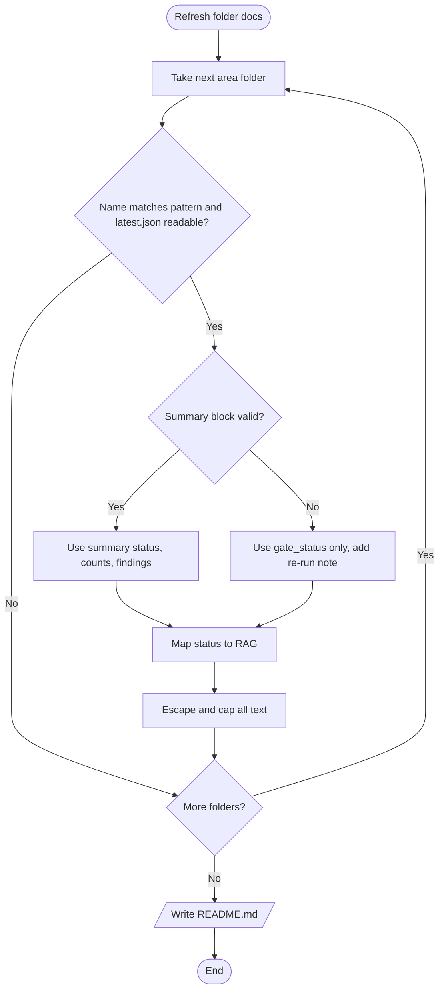
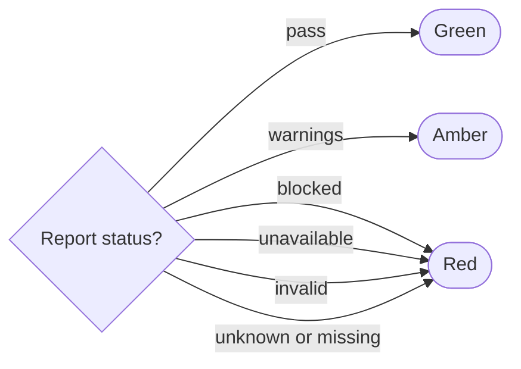

# Policy and evidence interpretation

Use this reference when reviewing a report, configuring stricter policy, or supplying reachability
evidence. Policy applies only after exact package applicability is established.

## Finding decision order

The first applicable default rule wins. Project policy may promote a warning to a block but cannot
downgrade a default block or KEV result.

| Condition | Default decision | Rationale |
|---|---|---|
| Advisory is withdrawn | Excluded | Retain provenance, but omit it from active counts. |
| CVE is in current CISA KEV | Block | Scope, reachability, severity, and fix availability do not weaken known exploitation. |
| No authoritative fixed version | Warning | Do not invent safety from a newer release. Release additionally needs mitigation and explicit risk acceptance. |
| Development-only dependency | Warning | A stricter project may block it. |
| Concrete evidence proves unreachable | Warning | Retain and review the exclusion evidence. |
| Non-development high/critical finding with a fix | Block | Applies to runtime or unknown scope when reachable, unknown, or not assessed. |
| Other active severity | Warning | Includes low, medium, and unknown unless promoted. |

## Stricter policy file

Supply `--policy /path/to/policy.json` with only these fields:

```json
{
  "block_warnings": false,
  "block_no_fix": true,
  "block_development": false,
  "block_proven_unreachable": false,
  "block_severities": ["medium"]
}
```

Boolean promotion fields affect their matching warnings. `block_severities` accepts only
`unknown`, `low`, `medium`, `high`, and `critical`. Unknown fields or wrong types make the invocation
invalid rather than silently changing policy.

## Mode and aggregate matrix

| Evidence or decision | Change | Main | Release |
|---|---|---|---|
| Complete inventory and matching baseline | Skip full remote scan | Not used | Not used |
| Incomplete inventory | Explicit warning/source gap; continue scanning | Unavailable | Unavailable |
| OSV, KEV, or applicable native adapter partial/unavailable/stale | Warning; retain known blocks | Unavailable | Unavailable |
| GitHub/NVD enrichment failure | Visible source gap; retain primary findings | Does not erase required-source completion | Does not erase required-source completion |
| Active blocking finding | Blocked unless required evidence is unavailable | Blocked | Blocked |
| No-fix warning without mitigation and acceptance | Warning | Warning | Unavailable |
| Report write failure | Unavailable | Unavailable | Unavailable |

The aggregate decision order, as a flow:



In main and release, required-evidence unavailability takes aggregate precedence over a known block,
but the block remains in the report. In change mode, a source gap prevents a `pass`: the outcome is
`warnings`, or `blocked` when a known blocking finding is also present.

## Report summary block

Every audit report (schema `1.1`) carries an area-neutral `summary`. The generated
`.security-audit/README.md` reads only this block, so a new audit area never needs the README to know
its finding shape. Status and counts come from the same gate result the exit code uses.

| Field | Meaning |
|---|---|
| `area` | Stable area name, matching the report's directory (`dependency-audit`). |
| `status` | The gate status: `pass`, `warnings`, `blocked`, `unavailable`, or `invalid`. |
| `mode` | `change`, `main`, or `release`. |
| `counts` | `blocking`, `warnings`, `excluded`, and `source_gaps` as non-negative integers. |
| `top_findings` | At most 10 active findings, known-exploited first then by severity: `severity`, `id`, `subject`, `flags`. |
| `more_findings` | How many active findings are not listed. |
| `source_gaps` | Sources that were `partial` or `unavailable`, as `source` and `state`. |

How a report becomes the folder summary:



The README treats every summary field as untrusted. Unknown enum values degrade to `invalid`, `-`, or
`unknown`; text is flattened, escaped, and capped at 200 characters; lists are capped; and a missing
or malformed summary (counts that are not plain integers) falls back to the report's `gate_status`
with a note to re-run the audit. A malformed summary can never make a result look better.



### RAG status

The README shows a red, amber, or green indicator per area and overall (the worst area's). It is
derived from `status` at render time and is not stored in the report. The word always accompanies the
symbol so colour is never the only signal, and anything not clearly `pass` or `warnings` is red.

| Status | RAG |
|---|---|
| `pass` | 🟢 Green |
| `warnings` | 🟠 Amber (review needed, never "clean") |
| `blocked`, `unavailable`, `invalid`, unknown, or missing | 🔴 Red |



## Release acceptance and remediation evidence

A release no-fix warning needs a recorded mitigation and approval, otherwise the result is
`unavailable`. Supply them with `--acceptances /path/to/acceptances.json`:

```json
{
  "schema_version": "1",
  "acceptances": {
    "pkg:pypi/example@1.2.3|OSV-2026-1": {
      "mitigation": "Network egress to the vulnerable parser is blocked.",
      "approval": "Approved by the security owner on 2026-11-17."
    }
  },
  "remediations": {
    "pkg:pypi/example@1.2.3|OSV-2026-1": {
      "target_version": "1.2.4",
      "context7_evidence": "Reviewed current migration notes.",
      "project_tests_passed": true,
      "post_change_audit_passed": true
    }
  }
}
```

Acceptance keys are `<exact-purl>|<advisory-id>` or a bare advisory ID for a project-wide record, and
both fields must be non-empty strings. Remediation keys are `<exact-purl>|<advisory-id>` or a bare
package URL; `target_version` is required and the other fields are `context7_evidence`,
`major_upgrade`, `replacement`, `explicit_approval`, `resolution_changed`, `project_tests_passed`,
and `post_change_audit_passed`. The file must be JSON no larger than 1 MiB with schema major `1`;
unknown fields, wrong types, or empty values make the invocation invalid (exit `3`). An acceptance
never downgrades a blocking finding or a KEV result, and recorded text appears in both reports.

## Reachability evidence

The document must be readable JSON no larger than 1 MiB, use schema major `1`, and contain an
`annotations` object. Keys combine an exact versioned package URL and stable advisory ID.

```json
{
  "schema_version": "1",
  "annotations": {
    "pkg:pypi/example@1.2.3|OSV-2026-1": {
      "status": "unreachable",
      "method": "delivered_artifact_exclusion",
      "evidence": ["evidence/bundle-manifest.json#excluded-components"],
      "producer": "release-bundle-analyzer",
      "timestamp": "2026-08-08T12:00:00Z"
    }
  }
}
```

| State | Accepted methods | Evidence rule |
|---|---|---|
| `reachable` | `direct_call`, `runtime_loading`, `enabled_configuration`, `execution_trace`, `dynamic_analysis` | Require one or more concrete evidence references. |
| `unreachable` | `delivered_artifact_exclusion`, `call_graph_exclusion`, `configuration_exclusion` | Require one or more concrete exclusion references. |
| `unknown` | Any non-empty review method | Record why analysis was inconclusive. |
| `not_assessed` | Any non-empty review method | Record that no assessment was made. |

Each annotation also requires a non-empty producer and timezone-aware timestamp. A key may contain a
list of independent producer records. Valid reachable evidence wins conflicts; other conflicts,
duplicate keys, unsupported methods, missing proof, and malformed supplied files fail closed to
unknown. Absence of an optional reachability file means not assessed.

Return to the [operational workflow](../SKILL.md).
